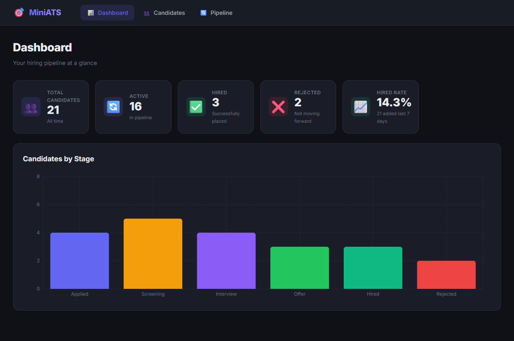
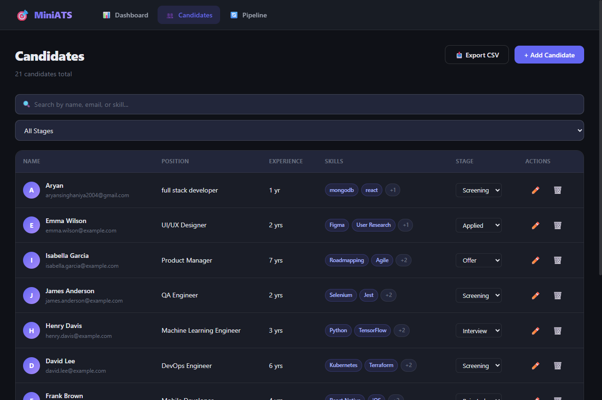
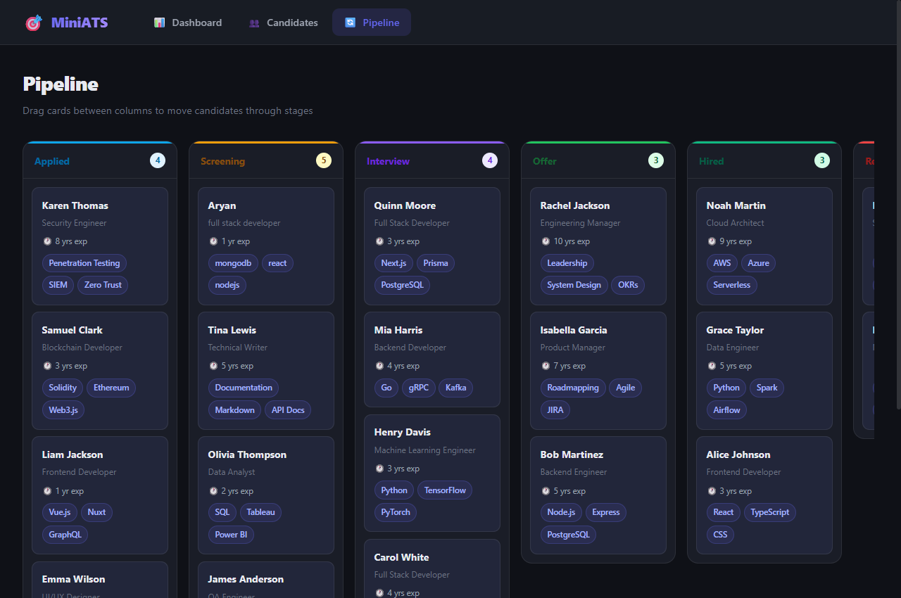

# 🎯 MiniATS — Mini Applicant Tracking System

A production-quality **Applicant Tracking System** built with the MERN stack. Manage candidates, track them through a hiring pipeline, search and filter, and view real-time dashboard analytics.

---

## ✨ Features

| Feature | Details |
|---|---|
| **Dashboard** | Stat cards + Recharts bar chart showing pipeline distribution |
| **Candidates Table** | Debounced search (300ms), stage filter, pagination, inline stage-change dropdown |
| **Add/Edit Candidate** | Modal form with client-side validation + server error display |
| **Pipeline (Kanban)** | Drag-and-drop with optimistic updates + rollback on failure |
| **Candidate Detail** | Full profile view with all fields and notes |
| **REST API** | 7 endpoints, pagination, text search, input validation, proper status codes |
| **Dark Mode UI** | Glassmorphism, smooth animations, responsive (mobile-friendly) |
| **Loading States** | Skeleton loaders + spinners everywhere |
| **Toast Notifications** | Success/error toasts on all mutations |
| **Empty States** | Friendly empty states when no data is found |

---

## 🛠 Tech Stack

**Backend**
- Node.js + Express
- Mongoose (MongoDB ODM)
- express-validator (input validation)
- morgan (HTTP logging)
- cors, dotenv

**Frontend**
- React (Vite)
- React Router DOM v6
- Axios (HTTP client)
- Recharts (dashboard chart)
- @hello-pangea/dnd (Kanban drag-and-drop)
- react-hot-toast (notifications)
- Vanilla CSS with custom design system

---

## 📸 Screenshots

> _(Replace with actual screenshots after running locally)_

| Dashboard | Candidates | Pipeline |
|---|---|---|
|  |  |  |

---

## 🚀 Local Setup

### Prerequisites
- Node.js 18+
- A [MongoDB Atlas](https://www.mongodb.com/atlas) account (free tier works)

### 1. Clone & Install

```bash
# Clone the repository
git clone https://github.com/AryanSinghaniya/MiniATS_Assignment.git
cd MiniATS_Assignment

# Install server dependencies
cd server
npm install

# Install client dependencies
cd ../client
npm install
cd ..
```

### 2. Configure Environment Variables

**Server** — copy and fill in your Atlas URI:
```bash
cp server/.env.example server/.env
```

Edit `server/.env`:
```env
PORT=5000
MONGO_URI=mongodb+srv://<username>:<password>@cluster0.xxxxx.mongodb.net/ats?retryWrites=true&w=majority
CLIENT_URL=http://localhost:5173
NODE_ENV=development
```

**Client** — already configured for local dev (no changes needed):
```bash
# client/.env
VITE_API_URL=http://localhost:5000/api
```

### 3. Seed the Database

```bash
cd server
npm run seed
cd ..
```

This inserts **20 realistic candidates** spread across all hiring stages.

### 4. Start Both Servers

In two separate terminals:

```bash
# Terminal 1 — Backend (port 5000)
cd server
npm run dev

# Terminal 2 — Frontend (port 5173)
cd client
npm run dev
```

Then open **http://localhost:5173** 🎉

---

## 🌍 Environment Variables

### Server (`server/.env`)

| Variable | Required | Description |
|---|---|---|
| `PORT` | No | Port for the Express server (default: 5000) |
| `MONGO_URI` | **Yes** | Full MongoDB Atlas connection string |
| `CLIENT_URL` | No | Frontend URL for CORS (default: http://localhost:5173) |
| `NODE_ENV` | No | `development` or `production` |

### Client (`client/.env`)

| Variable | Required | Description |
|---|---|---|
| `VITE_API_URL` | No | Backend API base URL (default: http://localhost:5000/api) |

---

## 📡 API Documentation

Base URL: `http://localhost:5000/api`

| Method | Endpoint | Description | Status Codes |
|---|---|---|---|
| `GET` | `/health` | Health check | 200 |
| `POST` | `/candidates` | Create a candidate | 201, 400, 409 |
| `GET` | `/candidates` | List with search/filter/pagination | 200 |
| `GET` | `/candidates/:id` | Get single candidate | 200, 404 |
| `PUT` | `/candidates/:id` | Update all fields | 200, 400, 404, 409 |
| `PATCH` | `/candidates/:id/stage` | Update stage only | 200, 400, 404 |
| `DELETE` | `/candidates/:id` | Delete candidate | 200, 404 |
| `GET` | `/dashboard` | Aggregated metrics | 200 |

### Query Parameters — `GET /api/candidates`

| Param | Type | Description |
|---|---|---|
| `search` | string | Full-text search on name, email, skills |
| `stage` | string | Filter by stage (Applied, Screening, etc.) |
| `page` | number | Page number (default: 1) |
| `limit` | number | Results per page (default: 10, max: 100) |
| `sort` | string | Mongoose sort string (default: `-createdAt`) |

### Example Response — `GET /api/candidates`

```json
{
  "success": true,
  "data": [ { "_id": "...", "name": "Alice Johnson", "stage": "Hired", ... } ],
  "pagination": { "total": 20, "page": 1, "limit": 10, "pages": 2 }
}
```

---

## 📁 Folder Structure

```
MiniATS_Assignment/
├── server/
│   ├── config/
│   │   └── db.js               # MongoDB connection
│   ├── controllers/
│   │   ├── candidateController.js  # All candidate CRUD logic
│   │   └── dashboardController.js  # Metrics aggregation
│   ├── middleware/
│   │   ├── asyncHandler.js     # Async try/catch wrapper
│   │   └── errorHandler.js     # Central error handler
│   ├── models/
│   │   └── Candidate.js        # Mongoose schema + text index
│   ├── routes/
│   │   ├── candidates.js       # /api/candidates routes
│   │   └── dashboard.js        # /api/dashboard route
│   ├── seed.js                 # 20 realistic test candidates
│   ├── server.js               # Express entry point
│   ├── .env                    # Your secrets (not committed)
│   └── .env.example            # Template
│
└── client/
    ├── src/
    │   ├── api/
    │   │   ├── axios.js        # Configured Axios instance
    │   │   └── candidates.js   # All API call functions
    │   ├── components/
    │   │   ├── Navbar.jsx
    │   │   ├── StatCard.jsx
    │   │   ├── StageBadge.jsx
    │   │   ├── CandidateTable.jsx
    │   │   ├── CandidateForm.jsx
    │   │   ├── KanbanBoard.jsx
    │   │   ├── Modal.jsx
    │   │   ├── ConfirmDialog.jsx
    │   │   ├── Pagination.jsx
    │   │   └── Skeleton.jsx
    │   ├── hooks/
    │   │   └── useDebounce.js  # 300ms debounce hook
    │   ├── pages/
    │   │   ├── Dashboard.jsx
    │   │   ├── Candidates.jsx
    │   │   ├── CandidateDetail.jsx
    │   │   ├── EditCandidate.jsx
    │   │   └── Pipeline.jsx
    │   ├── utils/
    │   │   └── constants.js    # Stages, colors, config
    │   ├── App.jsx             # Router + layout
    │   ├── main.jsx            # React entry point
    │   └── index.css           # Full design system
    ├── .env
    └── .env.example
```

---

## 🚢 Deployment Notes

### Backend (e.g., Render, Railway, Fly.io)
1. Set `NODE_ENV=production`
2. Set `MONGO_URI` to your Atlas connection string
3. Set `CLIENT_URL` to your deployed frontend URL
4. Run `npm start`

### Frontend (e.g., Vercel, Netlify)
1. Set `VITE_API_URL` to your deployed backend URL
2. Run `npm run build` — output is in `dist/`
3. Configure your host to redirect all routes to `index.html` (SPA routing)

### MongoDB Atlas
- Create a free M0 cluster
- Whitelist `0.0.0.0/0` for production (or your server IP)
- Create a database user and use the connection string in `MONGO_URI`

---

## 🔮 Future Improvements

- [ ] **Authentication** — JWT-based login for recruiters
- [ ] **Role-based access** — Recruiter vs. Admin vs. Viewer
- [ ] **Email notifications** — Auto-email candidates when stage changes
- [ ] **File uploads** — Resume/CV attachment per candidate
- [ ] **Interview scheduling** — Calendar integration
- [ ] **Activity timeline** — Log every stage change with timestamp + user
- [ ] **Export to CSV** — Download candidate list
- [ ] **Analytics** — Time-to-hire, source tracking, funnel conversion rates
- [ ] **Dark/Light mode toggle**
- [ ] **TypeScript migration** for better type safety

---

## 👨‍💻 Built By

Take-home assignment for **Full Stack Developer Intern** role.  
Stack: MongoDB · Express · React · Node.js
